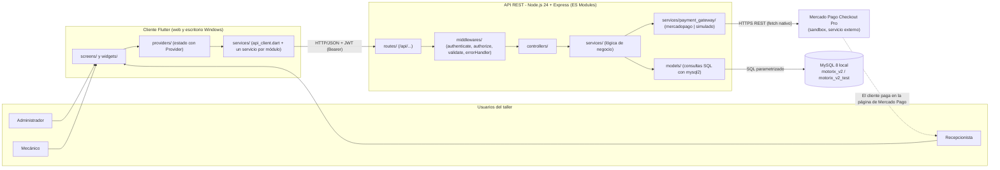
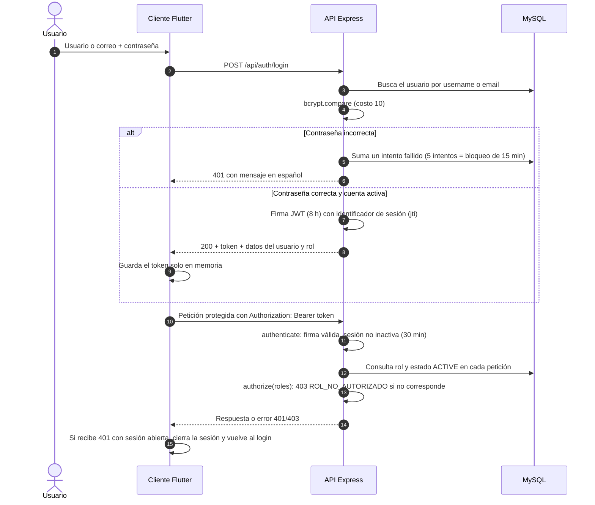

# 02. Arquitectura del sistema

**Proyecto:** Motorix, sistema de gestión para un taller mecánico
**Elaboró:** Carlos Castro Rafael
**Fecha de corte de los datos:** 2026-11-19 (rama `006-notificaciones-internas`)

> Las carpetas, archivos y endpoints de este documento se tomaron del código real (`server/`, `client/lib/`, `server/routes/`). Lo que no está decidido aparece como `[COMPLETAR: ...]`.

## 1. Diagrama de componentes

**Decisiones clave:**

- El cliente nunca habla con la base de datos ni con Mercado Pago; todo pasa por la API.
- La pasarela de cobro se elige al arrancar el servidor: con `MP_ACCESS_TOKEN` se usa Mercado Pago en sandbox; sin él, una pasarela simulada (`server/services/payment_gateway/index.js`). Motorix nunca recibe ni guarda datos de tarjeta.
- Comprobación de vida del servicio: `GET /api/salud` responde `{ "estado": "ok", "servicio": "motorix-api" }`.

## 2. Capas del backend (`server/`)

El backend no usa carpeta `src/`: las capas viven directamente en `server/` (decisión registrada en `docs/project-context.md` §27).

| Capa | Carpeta | Responsabilidad | Archivos reales |
|---|---|---|---|
| Arranque | `server.js`, `app.js` | `app.js` crea la aplicación Express, monta `/api` y el manejo centralizado de errores; `server.js` la pone a escuchar. | 2 |
| Configuración | `config/` | Lectura de variables de entorno (`env.js`) y pool de conexiones MySQL (`db.js`). | `db.js`, `env.js` |
| Rutas | `routes/` | Define cada endpoint y le encadena autenticación, rol y validación. `index.js` agrupa todo bajo `/api`. | 13 archivos `*.routes.js` + `index.js` |
| Middlewares | `middlewares/` | `auth.js` (verifica el JWT y la sesión), `authorize.js` (rol), `validate.js` (esquema zod), `asyncHandler.js`, `errorHandler.js` (respuesta de error sin trazas). | 5 |
| Validadores | `validators/` | Esquemas zod con mensajes en español (cliente, vehículo, orden, pago, etc.). | 13 |
| Controladores | `controllers/` | Traducen la petición HTTP a una llamada de servicio y arman la respuesta. Sin lógica de negocio. | 14 |
| Servicios | `services/` | **Toda la lógica de negocio** (principio II de la constitución): transiciones de estado, precio congelado, cobro, avisos. Incluye `order-lock.js` y la subcarpeta `payment_gateway/`. | 15 + `payment_gateway/` (3) |
| Modelos | `models/` | Acceso a datos: consultas SQL parametrizadas con `mysql2`, sin ORM. | 15 |
| Utilidades | `utils/` | Funciones puras compartidas: dinero, fechas locales, totales de orden, transiciones permitidas, almacén de sesiones (`sessionStore.js`), respuestas y errores. | 14 |
| Scripts | `scripts/` | `create-admin.js` para crear el administrador inicial. | 1 |
| Pruebas | `tests/` | `unit/`, `integration/`, `contract/` y `helpers/` (preparación única de la base de pruebas y cierre del pool). | — |

## 3. Capas del cliente (`client/lib/`)

| Capa | Carpeta | Responsabilidad | Archivos reales |
|---|---|---|---|
| Entrada | `main.dart` | Crea el `MultiProvider`, las rutas protegidas y el cierre de sesión. | 1 |
| Pantallas | `screens/` | Una pantalla por caso de uso: login, recepción, clientes, vehículos, citas, órdenes, refacciones, mantenimiento, pago, ticket, dashboard, usuarios, clientes por avisar, cuenta. | 26 |
| Widgets | `widgets/` | Componentes reutilizables: `app_shell.dart` (marco con menú), `app_table.dart`, `notification_bell.dart` (campana de avisos), chips de estado, diálogo de confirmación. | 7 |
| Providers | `providers/` | Estado de cada módulo con `ChangeNotifier` (Provider): carga, error, datos y acciones. | 17 |
| Servicios | `services/` | `api_client.dart` (HTTP, encabezado `Authorization`, manejo de 401) y un servicio por módulo de la API. | 15 |
| Modelos | `models/` | Clases Dart que convierten el JSON de la API (`fromJson`). | 17 |
| Utilidades | `utils/` | Rutas (`app_routes.dart`), tema Material 3 (`app_theme.dart`), formatos, validadores, mensajes e impresión del ticket (`print_service_web.dart` / `print_service_stub.dart`). | 9 |

## 4. Autenticación y permisos por rol

### 4.1 Flujo de autenticación

**Reglas implementadas** (`server/services/auth.service.js`, `server/middlewares/auth.js`, `server/config/env.js`):

- Inicio de sesión con **usuario o correo** en el mismo campo.
- Contraseñas con **bcryptjs**, costo 10; nunca se guardan en texto plano.
- **Bloqueo**: 5 intentos fallidos consecutivos bloquean la cuenta 15 minutos.
- **Token JWT** con vigencia de 8 horas (`JWT_EXPIRA_EN`) e **inactividad** de 30 minutos (`SESSION_IDLE_MS`), controlada en `utils/sessionStore.js`.
- El **rol y el estado** se leen de la base en cada petición: si un administrador desactiva una cuenta o cambia un rol, el efecto es inmediato.
- Los permisos se validan **en el backend** (`authorize.js`); ocultar botones en el cliente no se considera seguridad.
- Los errores llegan al cliente con mensaje y código en español, sin trazas de error (stack traces).

### 4.2 Matriz de permisos por grupo de endpoints

| Grupo | ADMIN | RECEPTIONIST | MECHANIC |
|---|---|---|---|
| Autenticación (`/auth`) | Sí | Sí | Sí |
| Usuarios (`/users`) | Sí | Solo lista de mecánicos | No |
| Clientes (`/clients`) | Sí | Sí | No |
| Vehículos (`/vehicles`) | Sí | Sí | Solo historial |
| Citas (`/appointments`) | Sí | Sí | No |
| Órdenes de servicio (`/service-orders`) | Sí | Crear, editar, asignar, refacciones, estado | Consultar sus órdenes, diagnóstico, servicios, refacciones, recomendaciones, estado |
| Mantenimiento (`/maintenance`) | Sí | Consultar | Consultar, registrar, editar, marcar realizado |
| Refacciones (`/parts`) | Sí (alta, edición, baja, movimientos) | Consultar | Consultar (sin ningún precio, Sprint 5) |
| Pagos (`/payments`) | Sí (incluye anular) | Registrar, confirmar, consultar | No |
| Tickets (`/tickets`) | Sí | Sí | No |
| Dashboard (`/dashboard`) | Sí (exclusivo) | No | No |
| Notificaciones (`/notifications`) | Sí (las de su rol) | Sí (las de su rol) | Sí (solo de sus órdenes) |
| Clientes por avisar (`/client-notices`) | Sí | Sí | No |

## 5. Endpoints reales por grupo

Todos cuelgan de `/api` (`server/routes/index.js`). «Roles» indica el middleware `authorize` del archivo de rutas.

| Grupo | Método y ruta | Roles |
|---|---|---|
| Salud | `GET /api/salud` | Público |
| Auth | `POST /auth/login` | Público |
| Auth | `POST /auth/logout`, `GET /auth/me`, `POST /auth/change-password` | Sesión iniciada |
| Usuarios | `GET /users/mechanics` | ADMIN, RECEPTIONIST |
| Usuarios | `GET /users`, `POST /users`, `PATCH /users/:id` | ADMIN |
| Clientes | `GET /clients`, `POST /clients`, `GET /clients/:id`, `PUT /clients/:id` | ADMIN, RECEPTIONIST |
| Vehículos | `GET /vehicles`, `POST /vehicles`, `GET /vehicles/:id`, `PUT /vehicles/:id` | ADMIN, RECEPTIONIST |
| Vehículos | `GET /vehicles/:id/history` | ADMIN, RECEPTIONIST, MECHANIC |
| Citas | `GET /appointments`, `POST /appointments`, `GET /appointments/:id`, `PUT /appointments/:id`, `POST /appointments/:id/cancelar`, `POST /appointments/:id/recibir` | ADMIN, RECEPTIONIST |
| Órdenes | `GET /service-orders`, `GET /service-orders/:id` | ADMIN, RECEPTIONIST, MECHANIC |
| Órdenes | `POST /service-orders`, `PUT /service-orders/:id`, `POST /service-orders/:id/asignar` | ADMIN, RECEPTIONIST |
| Órdenes | `POST /service-orders/:id/diagnostico`, `POST /service-orders/:id/servicios`, `DELETE /service-orders/:id/servicios/:servicioId`, `POST /service-orders/:id/recomendaciones` | ADMIN, MECHANIC |
| Órdenes | `POST /service-orders/:id/refacciones`, `DELETE /service-orders/:id/refacciones/:refaccionId` (y sus alias `/repuestos`), `POST /service-orders/:id/estado` | ADMIN, RECEPTIONIST, MECHANIC |
| Mantenimiento | `GET /maintenance`, `GET /maintenance/:id` | ADMIN, RECEPTIONIST, MECHANIC |
| Mantenimiento | `POST /maintenance`, `PUT /maintenance/:id`, `POST /maintenance/:id/realizar` | ADMIN, MECHANIC |
| Refacciones | `GET /parts`, `GET /parts/:id`, `GET /parts/:id/movements` | ADMIN, RECEPTIONIST, MECHANIC |
| Refacciones | `POST /parts`, `PUT /parts/:id`, `POST /parts/:id/desactivar`, `POST /parts/:id/movements` | ADMIN |
| Pagos | `GET /payments/orden/:ordenId`, `GET /payments/orden/:ordenId/total`, `POST /payments`, `POST /payments/:id/confirmar` | ADMIN, RECEPTIONIST |
| Pagos | `POST /payments/:id/anular` | ADMIN |
| Tickets | `POST /tickets`, `GET /tickets/orden/:ordenId`, `GET /tickets/:id` | ADMIN, RECEPTIONIST |
| Dashboard | `GET /dashboard` | ADMIN (exclusivo) |
| Notificaciones | `GET /notifications`, `GET /notifications/count`, `POST /notifications/read` | Sesión iniciada (filtradas por rol) |
| Clientes por avisar | `GET /client-notices`, `POST /client-notices` | ADMIN, RECEPTIONIST |

**Total:** 13 grupos de recursos y 63 rutas, más `GET /api/salud`.

## 6. Despliegue

`[COMPLETAR: hosting por definir]`

Lo que sí está decidido en la constitución (enmienda 1.1.0, 2026-11-13):

- El despliegue en hosting **para la demostración escolar** forma parte del alcance oficial, igual que el **aviso de privacidad visible en la app**.
- Se permite **una instancia en la nube** (backend, frontend web y MySQL 8) **solo para la demostración**; el desarrollo y las pruebas siguen en MySQL local.
- Las credenciales viven únicamente en las variables de entorno del proveedor de hosting, nunca en el repositorio.
- Nunca se ejecutan pruebas contra la base de la nube.
- Dato técnico útil para el despliegue: el cliente lee la dirección de la API de `--dart-define=API_BASE_URL`; `arrancar.ps1` ya compila la versión web con `API_BASE_URL=/api`, lo que permite servir el frontend y la API desde el mismo dominio.

Pendientes: `[COMPLETAR: proveedor de hosting]`, `[COMPLETAR: proveedor de MySQL 8 en la nube]`, `[COMPLETAR: dominio o URL pública de la demostración]`, `[COMPLETAR: fecha del despliegue]`.
