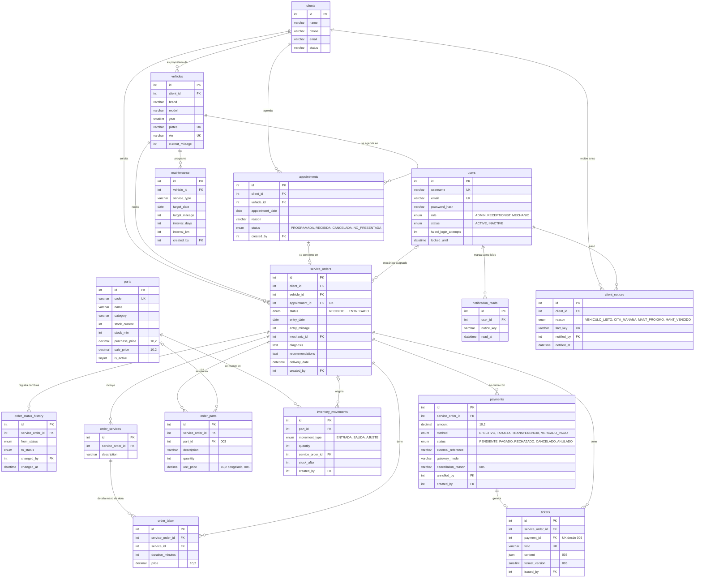

# 03. Esquema de la base de datos

**Proyecto:** Motorix, sistema de gestión para un taller mecánico
**Elaboró:** Carlos Castro Rafael
**Fecha de corte de los datos:** 2026-11-19 (rama `006-notificaciones-internas`)

> Este esquema se reconstruyó leyendo las **siete migraciones** de `database/migrations/` (001 a 007) y el script `database/scripts/aplicar-migraciones.ps1`. Motor: MySQL 8. Bases: `motorix_v2` (desarrollo) y `motorix_v2_test` (pruebas).

## 1. Diagrama entidad-relación

El diagrama muestra las 16 tablas de negocio con su llave primaria (PK), sus llaves foráneas (FK), las llaves únicas (UK) y las columnas más importantes. Las columnas `created_at` y `updated_at` se omiten para que el diagrama sea legible.

**Llaves foráneas hacia `users` omitidas en las líneas del diagrama** (para no saturarlo; todas existen en las migraciones): `appointments.created_by`, `service_orders.created_by`, `order_status_history.changed_by`, `inventory_movements.created_by`, `maintenance.created_by`, `payments.created_by`, `payments.annulled_by` y `tickets.issued_by`. Sirven de **bitácora de quién hizo cada acción**.

## 2. Tablas, migración que las creó y propósito

| Tabla | Migración / sprint que la creó | Propósito |
|---|---|---|
| `users` | `001_esquema_inicial.sql` / Sprint 1 | Cuentas del personal con rol (ADMIN, RECEPTIONIST, MECHANIC), estado y control de intentos fallidos y bloqueo. |
| `clients` | `001_esquema_inicial.sql` / Sprint 1 | Propietarios de los vehículos (nombre, teléfono, correo). |
| `vehicles` | `001_esquema_inicial.sql` / Sprint 1 | Vehículos con su propietario; placa única y número de serie (VIN) opcional pero único. |
| `appointments` | `002_citas_ordenes_servicio.sql` / Sprint 2 | Citas de llegada al taller y su estado (programada, recibida, cancelada, no presentada). |
| `service_orders` | `002_citas_ordenes_servicio.sql` / Sprint 2 | Orden de servicio: cliente, vehículo, cita de origen (una cita genera como máximo una orden), mecánico, diagnóstico, recomendaciones y estado. |
| `order_status_history` | `002_citas_ordenes_servicio.sql` / Sprint 2 | Bitácora de cada cambio de estado de la orden, con quién y cuándo. |
| `order_services` | `002_citas_ordenes_servicio.sql` / Sprint 2 | Servicios realizados en la orden. |
| `order_labor` | `002_citas_ordenes_servicio.sql` / Sprint 2 | Mano de obra de cada servicio: duración y precio. |
| `order_parts` | `002_citas_ordenes_servicio.sql` / Sprint 2 (ampliada en 003 y 005) | Refacciones usadas en la orden. La 003 agrega `part_id` (liga con el catálogo); la 005 agrega `unit_price` (precio congelado). |
| `parts` | `003_historial_mantenimiento_inventario.sql` / Sprint 3 | Catálogo de refacciones: código único, categoría, marca, stock actual y mínimo, precios de compra y venta. |
| `maintenance` | `003_historial_mantenimiento_inventario.sql` / Sprint 3 | Próximo mantenimiento por vehículo y tipo de servicio (por fecha y/o kilometraje, con anticipación). |
| `inventory_movements` | `003_historial_mantenimiento_inventario.sql` / Sprint 3 | Entradas, salidas y ajustes de inventario con el stock resultante; puede ligarse a una orden. |
| `payments` | `004_pagos_tickets_dashboard.sql` / Sprint 4 (ampliada en 005) | Pagos de una orden: importe, método, estado, referencia de Mercado Pago y anulación. La 005 agrega `cancellation_reason`. |
| `tickets` | `004_pagos_tickets_dashboard.sql` / Sprint 4 (ampliada en 005) | Comprobante con folio único. La 005 cambia la regla «un ticket por orden» por «un ticket por pago» y guarda una copia inmutable del contenido (`content` JSON, `format_version`). |
| `notification_reads` | `007_notificaciones_internas.sql` / Sprint 6 | Qué avisos internos marcó como leídos cada usuario (un registro por usuario y aviso). Los avisos se calculan con datos reales; no se guardan. |
| `client_notices` | `007_notificaciones_internas.sql` / Sprint 6 | Registro de clientes ya avisados (vehículo listo, cita de mañana, mantenimiento próximo o vencido) para no repetir el aviso. |
| `schema_migrations` | `database/scripts/aplicar-migraciones.ps1` (no es una migración) | Control técnico: nombre y fecha de cada migración aplicada, para no aplicarla dos veces. |

### Migraciones sin tablas nuevas

| Migración | Sprint | Qué hace |
|---|---|---|
| `003_...` (parte final) | Sprint 3 | `ALTER TABLE order_parts` agrega `part_id` con FK a `parts`; índice `idx_service_orders_vehicle_status` para el historial del vehículo. |
| `005_precios_congelados_tickets_por_pago.sql` | Sprint 5 | **Solo esquema:** agrega `order_parts.unit_price`, `tickets.content`, `tickets.format_version` y `payments.cancellation_reason`; reemplaza el índice único `uq_tickets_service_order` por `uq_tickets_payment` (cambio de restricción permitido y documentado en el plan del Sprint 5). |
| `006_datos_precio_congelado_copia_tickets.sql` | Sprint 5 | **Solo datos**, dentro de una transacción y repetible: congela el precio de las líneas existentes y copia los tickets anteriores en la versión 1 del formato. |
| `007_notificaciones_internas.sql` | Sprint 6 | Crea `notification_reads` y `client_notices`. |

### Datos de ejemplo (seeds)

`database/seeds/` contiene seis scripts (`001_datos_iniciales.sql` a `006_ejemplos_notificaciones.sql`), uno por sprint con cambios de datos. Se aplican con `aplicar-migraciones.ps1 -Seeds`.

## 3. Reglas del diseño de la base

| Regla | Cómo se cumple |
|---|---|
| **Motor InnoDB** | Todas las tablas declaran `ENGINE=InnoDB`: transacciones y llaves foráneas reales. |
| **Juego de caracteres utf8mb4** | Todas usan `DEFAULT CHARSET=utf8mb4 COLLATE=utf8mb4_unicode_ci`: acentos, eñes y cualquier carácter en español. |
| **Importes `DECIMAL(10,2)`** | `order_labor.price`, `order_parts.unit_price`, `parts.purchase_price`, `parts.sale_price` y `payments.amount`. Nunca `FLOAT`, para no perder centavos por redondeo binario. |
| **Migraciones inmutables y numeradas** | Una migración aplicada no se edita; cada cambio va en un script nuevo (`008_...`). «Aditiva» significa no borrar tablas, columnas ni datos. Se permite reemplazar una restricción conservando los datos y documentándolo (caso de la 005). |
| **Seeds idempotentes** | Se pueden correr varias veces sin duplicar datos: usan ids fijos con `INSERT IGNORE`, `ON DUPLICATE KEY` o `WHERE NOT EXISTS`. |
| **Contraseñas** | Solo hash bcrypt en `users.password_hash`; nunca texto plano. |
| **Sin datos de tarjeta** | `payments` guarda solo la referencia externa y el enlace de Mercado Pago; ningún número de tarjeta. |
| **Integridad del historial** | El precio de una refacción se **congela** en `order_parts.unit_price` al agregarla y cada ticket guarda una copia de su contenido; un cambio posterior del catálogo no altera órdenes, pagos ni tickets emitidos. |
| **Base local** | Desarrollo y pruebas en MySQL local; una instancia en la nube solo para la demostración (enmienda 1.1.0). |
